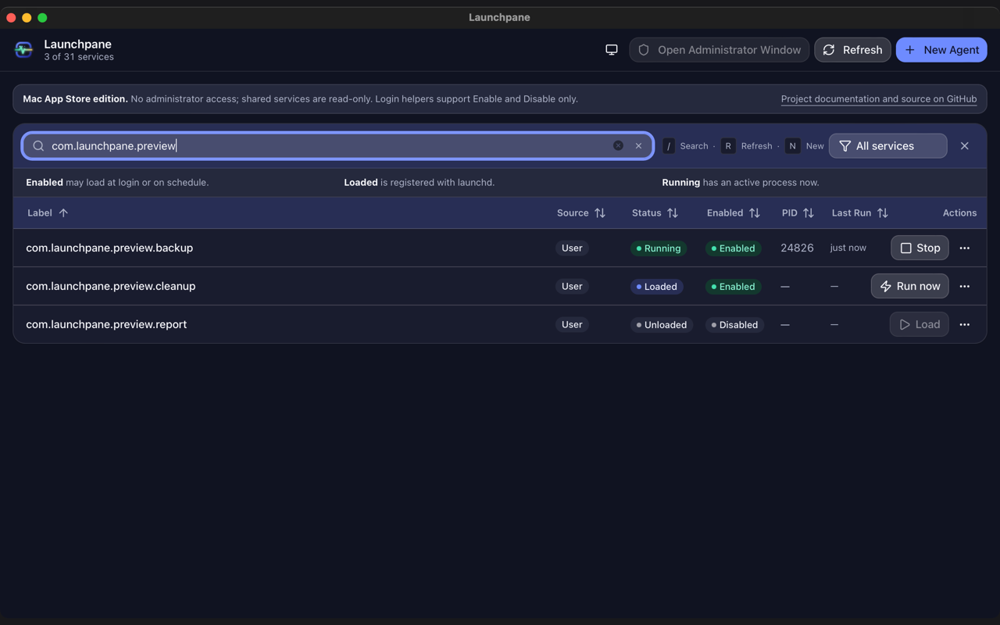
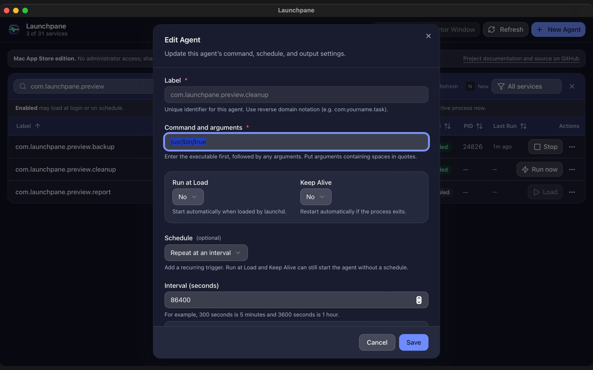
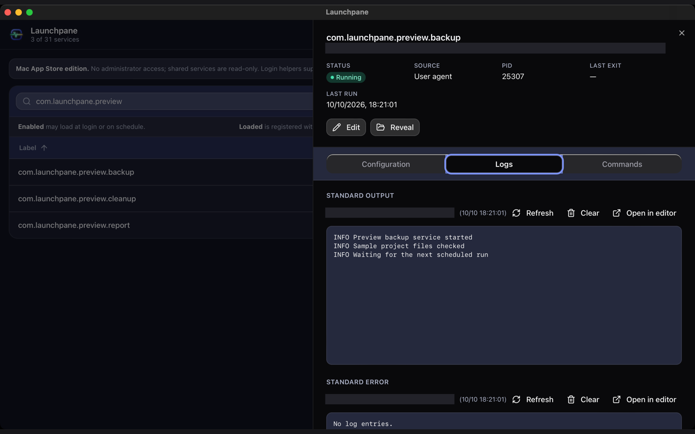

  

  <strong>Know what starts on your Mac.</strong> 
  See, understand, and control the background services, launch agents, and login items on your Mac.

  
  
  
  
  

  <a href="https://github.com/webmaxru/Launchpane/releases/latest"><strong>Download standalone (recommended)</strong></a> ·
  <a href="#mac-app-store">Mac App Store</a> ·
  <a href="https://salnikov.no/projects/launchpane/">Website</a> ·
  <a href="https://salnikov.no/projects/launchpane/support/">Support</a> ·
  <a href="https://salnikov.no/projects/launchpane/privacy/">Privacy</a>

  

Apps quietly install helpers that start at login, run on a schedule, or keep
running in the background. macOS keeps them in several folders and only exposes
them through the `launchctl` command line. Launchpane puts all of them in one
native window, so you can see what is there, what it runs, whether it is working,
and switch it off when you do not want it.

## What you can do

- **See everything in one list.** Your own launch agents, shared and system
  agents, system daemons, and app login items—searchable and filterable by source.
- **Understand each service.** Read its program, arguments, schedule, and full
  configuration in plain view, and reveal its file in Finder.
- **Find out why something fails.** Open its output and error logs next to the
  service, with its current state and last exit code.
- **Take control.** Load, run now, stop, restart, enable, or disable services,
  with clear reasons when an action is unavailable.
- **Create and edit your own agents.** Build a launch agent with a form, set an
  interval or calendar schedule, and preview the next run time—no hand-written
  XML required.
- **Stay safe.** Protected system files stay read-only. System daemons need an
  explicit administrator window, and unloading a login helper asks first.

  
  

Want every detail? See which actions are available for each kind of service and
why in the [action reference](docs/native-actions.md).

## Install

Both editions are free. **We recommend standalone for service management**:
it includes Load, Run now, Stop/Unload, Restart, Enable/Disable, personal-agent
removal, and explicit administrator controls that the Store edition cannot offer.

### Standalone (recommended)

Download the latest [signed standalone release](https://github.com/webmaxru/Launchpane/releases/latest)
for the complete service-management workflow, subject to macOS permissions.

Choose the Apple Silicon (`aarch64`), Intel (`x64`), or Universal DMG, open it,
and drag Launchpane to Applications. Follow the normal macOS installation
prompts—do not remove quarantine attributes.

App archives are also available, including `Launchpane_universal.app.tar.gz`.
Each release includes `SHA256SUMS` for all six downloads. Standalone builds
are separate from the sandboxed Mac App Store edition. The older v1.2.1
assets remain unsigned and are not replaced.

#### Why trust the standalone download?

Official standalone releases from **v1.2.2** are **Developer ID signed and Apple
notarized**. Downloading outside the App Store does not mean bypassing macOS
security:

- **Developer ID signing** lets macOS verify the identified developer and detect
  changes to the signed app.
- **Apple notarization** checks the submitted software for known malware.
  The release pipeline staples Apple's notarization tickets to the app and DMG.
- **Gatekeeper** checks downloaded software before it runs. The release pipeline
  verifies Gatekeeper acceptance before publishing.

These are meaningful protections, not a guarantee that software is risk-free or
the same as App Store review. Standalone is not restricted by App Sandbox and can
change real services; review each action and grant administrator access only when
needed. Get it from the official release page, optionally compare the download
with `SHA256SUMS`, and keep Gatekeeper enabled. If macOS reports damaged software,
an unverifiable developer, or malware, stop rather than bypass the warning.
See [Apple's explanation of safely opening Mac apps](https://support.apple.com/en-us/102445).

### Mac App Store

  

Now available on the Mac App Store as a **sandboxed service inspector and
personal LaunchAgent plist editor**. App Store sandbox and privilege restrictions
limit this edition's features:

- Inspect service state, configuration, schedules, and selected logs; create and
  edit personal LaunchAgent plists.
- No Load, Run now, Stop/Unload, Restart, Enable/Disable, Remove, or administrator
  mode. Shared services and login helpers are inspection-only.
- Choose inventory and log folders in the native picker on each app launch;
  access grants last only until quit.
- Saving a personal plist saves the file only: it does **not** activate or reload
  the service. Copied Terminal commands are references, not executed by the app.

Choose this edition if inspection and plist editing are enough. For service
control, use the [recommended standalone download](https://github.com/webmaxru/Launchpane/releases/latest).
The Store app does not download, install, or unlock another edition.

## Questions

**Which edition should I choose?**
Choose standalone if you want to stop, start, enable, disable, or remove
services. Choose the Mac App Store edition if you only need to inspect services
and edit your own launch agents. Both are free. Compare them in the
[edition guide](docs/app-store-actions.md).

**Can Launchpane break my Mac?**
Protected system files cannot be edited or removed, and system daemons are only
controlled from an administrator window that you open on purpose. Changes to
your own agents and login items take effect immediately, so read the action
before confirming. Disabling a service is reversible; enabling it again does
not always start it right away.

**What are login items?**
Background helpers that apps register with macOS
(`<App>.app/Contents/Library/LoginItems/<Helper>.app`). They have no
configuration file, so Launchpane offers Enable and Disable and, while they are
registered, Run now, Restart, and Unload. Only the parent app can register an
unloaded helper again.

**Does Launchpane collect data?**
No. It works offline and has no analytics, tracking, accounts, or cloud
service. Read the [privacy policy](https://salnikov.no/projects/launchpane/privacy/).

## Support

Questions, bug reports, and feature ideas are welcome. See the
[support page](https://salnikov.no/projects/launchpane/support/) for how to get
help.

## For developers

Launchpane is open source and built with Tauri, Rust, React, and TypeScript.

- [DEVELOPMENT.md](DEVELOPMENT.md) — build from source, run tests, and project structure.
- [DEPLOYMENT.md](DEPLOYMENT.md) — signed releases, Mac App Store publishing, and the website.

## Credits

Launchpane builds on [launchd-ui](https://github.com/azu/launchd-ui) by
[azu](https://github.com/azu) and its contributors.

## License

Launchpane is released under the [MIT License](LICENSE), which is shipped inside
the application bundle at `Contents/Resources/LICENSE`.

The [Mac App Store badge](docs/assets/mac-app-store-badge.svg) is
[unmodified artwork supplied by Apple](https://developer.apple.com/app-store/marketing/guidelines/images/badge-download-on-the-mac-app-store.svg),
used under Apple's [marketing guidelines and artwork license](https://developer.apple.com/app-store/marketing/guidelines/),
not the project's MIT License. Keep its proportions, a minimum height of 40 px,
and clear space of at least one-quarter of its height.
Apple, the Apple logo, Mac, and macOS are trademarks of Apple Inc., registered in
the U.S. and other countries. Mac App Store is a service mark of Apple Inc.
